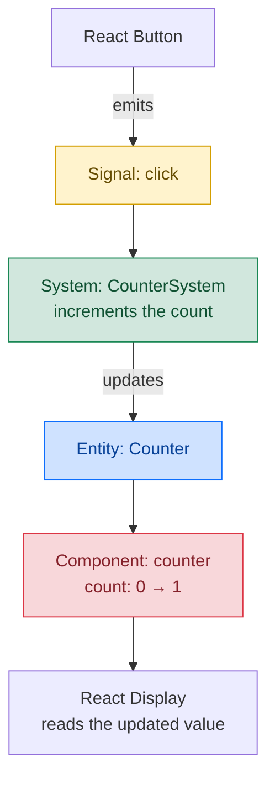

# ecs-react

[](https://www.npmjs.com/package/ecs-react)
[](https://badgen.net/bundlejs/minzip/ecs-react)
[](https://www.npmjs.com/package/ecs-react)

A lightweight [Entity Component System (ECS)](https://en.wikipedia.org/wiki/Entity_component_system) implementation for React applications. This architecture allows React components to serve purely as renderers, while all state management and business logic is handled by the ECS pattern.

This provides a type-safe and scalable way to manage complex state and behavior, particularly useful for any React application that benefits from decoupled state and rendering logic.

## Installation

```bash
npm install ecs-react
# or
yarn add ecs-react
```

## Why ECS over Traditional State Management?

Unlike traditional state management solutions like Redux or MobX, which organize state around a global store or observable objects, `ecs-react` takes a fundamentally different approach:

- **Composition over Global State**: Instead of a global state tree, state is organized around entities and their components, making it easier to add/remove features dynamically
- **Behavior Separation**: Systems handle logic independently of data (components) and presentation (React components), creating cleaner separation than reducer/action patterns

## Overview

`ecs-react` implements the Entity Component System (ECS) pattern, which consists of:

- **Entities**: Base objects that serve as containers for components
- **Components**: Pure data containers that define the properties of entities
- **Systems**: Logic that operates on entities with specific components
- **Signals**: Events that trigger system behaviors

At a high level, an entity is the thing being described, its components hold
the data, and systems change that data in response to signals. For example, a
counter button can send a `click` signal for a counter entity:



Here, the **Entity** is the counter instance, the **Component** stores its
count, the **System** contains the increment logic, and the **Signal** tells
the system when to run. The React display reads the updated component and
re-renders.

## Core Concepts

👉 Complete counter example: [examples/counter](https://github.com/hasnainroopawalla/ecs-react/tree/main/examples/counter/main.tsx)

### 1. Defining Types

First, define your Component and Signal schemas:

```typescript
import { ComponentSchema, SignalSchema } from "ecs-react";

// Define all your Component types
type MyComponents = ComponentSchema<{
  counter: { count: number };
  label: string;
}>;

// Define all possible Signal types
type MySignals = SignalSchema<"click" | "hover">;
```

### 2. Creating an ECS Instance

Create a typed instance of the ECS:

```typescript
import { ECS } from "ecs-react";

const ecs = new ECS<MyComponents, MySignals>();
```

### 3. Working with Entities

Entities are created and managed through the ECS instance:

```typescript
// Create a new entity
const counterEntity = ecs.createEntity();

// Add components to the entity
counterEntity.addComponent("counter", { count: 0 });
counterEntity.addComponent("lastUpdatedAt", { count: Date.now() });
```

### 4. Creating Systems

Systems define behavior that operates on entities when specific signals are received:

```typescript
ecs.createSystem({
  name: "counterSystem",
  signals: ["click"],
  fn: ({ entity }) => {
    entity.updateComponent("counter", prevValue => ({
      count: prevValue.count + 1,
    }));
  },
});
```

The above system will run when the `click` signal is received.

### 5. Using with React Components

React components can interact with entities using the provided hooks:

```typescript
import { useComponent, WithEntityProps } from "ecs-react";

// Button that executes the click signal on the counter entity
const Button: React.FC<WithEntityProps<MyComponents>> = ({ entity }) => {
  const onClick = () => ecs.signal("click", entity);

  return <button onClick={onClick}>Click</button>;
};

// Display component that shows the counter entity
const Display: React.FC<WithEntityProps<MyComponents>> = ({ entity }) => {
  // internally subscribes to updates on the counter component of the entity
  const counter = useComponent(entity, "counter");

  return <span>{counter?.count}</span>;
};
```

## Contributing

Post any issues and suggestions on the [GitHub issues](https://github.com/hasnainroopawalla/ecs-react/issues) page.
To contribute, fork the project and then create a pull request back to _main_.
